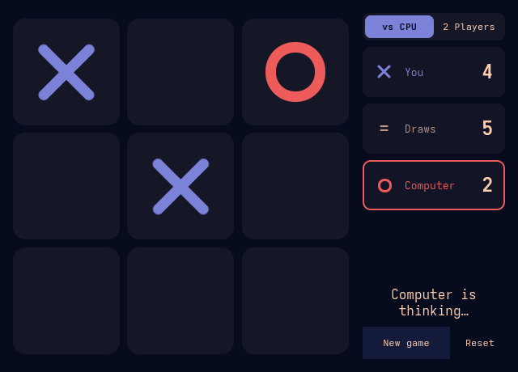
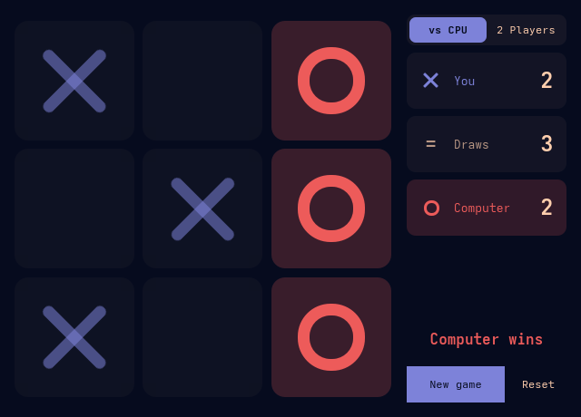
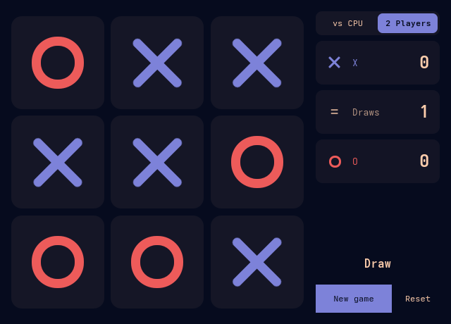

# TicTacToe for SUPER DESKTOP

A simple tic-tac-toe game that stays on the
[SUPER DESKTOP](https://github.com/gladimdim/super-desktop) desktop: a panel
with a big board and the score beside it. Play the computer or a friend.

| Your turn | The computer wins | Two players, a draw |
| --- | --- | --- |
|  |  |  |

## Use it

- **Click a square** to play. Against the computer you are X; in
  **2 Players** mode X and O take turns at one mouse. The other player starts
  the next game.
- **The score** (you, draws, computer) is on the right; the player to move is
  outlined. Each mode keeps its own score; **Reset** clears it.
- **New game**, or a click on a finished board, starts the next game.
- The computer wins when it can, blocks you when it must, and likes the centre
  and corners. A fork beats it.

The panel opens when SUPER DESKTOP starts and stays open while SUPER
DESKTOP is hidden. Close it with ✕ and it stays closed; the small **#** in
the top bar brings it back. To turn it off completely, use Settings →
Plugins. The game in progress and the score survive closing the panel and
restarting SUPER DESKTOP. Colors come from your Omarchy theme.

## Install

Needs SUPER DESKTOP 1.6.0 or newer.

```sh
super-desktop plugin install https://github.com/gladimdim/super-desktop-tictactoe
super-desktop plugin approve tictactoe
```

Or approve it in Settings → Plugins, where **Ask AI to review** reads it first.

## What it does on your PC

- Saves the board, the mode and the score in SUPER DESKTOP's plugin values
  (`~/.local/state/super-desktop/plugins/tictactoe.data.json`).
- Asks SUPER DESKTOP to open its own panel (`panel.open`).
- Nothing else: no network, no other files, no programs.

## Change it

It is plain QML: edit a file and SUPER DESKTOP reloads it. `AGENTS.md`
describes how it works for an AI agent; `super-desktop plugin check tictactoe`
and `super-desktop plugin snapshot tictactoe --surface game` check your edits.

## License

MIT
